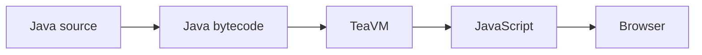

I've been spending some time looking at TeaVM, and I think it's an interesting project.

TeaVM compiles Java bytecode into JavaScript and WebAssembly. That gives Java developers another way to build applications that run in the browser.

I wanted to put together a few examples to show what that looks like in practice. Rather than compiling a class and stopping at the output, I wanted to take Java code and turn it into something you can interact with in a browser.

Let's start with a number-guessing game. It's a small example, but it gives us a chance to look at the Java code, see where TeaVM fits, and explore how that code interacts with a web page.

<!-- EDITORIAL NOTE: The code, generated output and screenshot below come from the TeaVM showcase repository. Verify them against the current build before publishing. -->

## A little Java game

The game picks a number, the player enters a guess, and the game says whether it's too high, too low, or correct. The rules live in an ordinary Java class:

```java
public GuessResult submitGuess(int guess) {
    if (complete) {
        return GuessResult.GAME_OVER;
    }
    if (guess < 1 || guess > 10) {
        return GuessResult.INVALID;
    }

    guessCount++;
    if (guess < target) {
        return GuessResult.TOO_LOW;
    }
    if (guess > target) {
        return GuessResult.TOO_HIGH;
    }
    complete = true;
    return GuessResult.CORRECT;
}
```

This method is from [`NumberGame.java`](https://github.com/teggr/teavm-showcase/blob/main/teavm-showcase-number-guessing/src/main/java/io/github/teggr/teavmshowcase/numberguessing/NumberGame.java). The game model also chooses a random target and tracks the number of valid guesses. It has no browser dependencies, so the same rules can be tested on the JVM.

That gives us the application logic in Java. To make a game people can use, we also need a way to accept input and display the result.

## From Java to the browser

This is where TeaVM comes in.

TeaVM compiles Java bytecode into code that can run in the browser. In this example, Maven first compiles the Java source, then the TeaVM Maven plugin compiles the bytecode to JavaScript. The project uses TeaVM 0.16.0 and Java 17.

The important distinction is that TeaVM works with compiled Java bytecode. Our regular Java build produces that bytecode, and TeaVM takes it from there.



Once compiled, the Java application can run as part of a web page. The HTML handles the page structure, and Java handles the game logic.

## Connecting Java to the DOM

The page needs a number input, a button and somewhere to display the result. When the player clicks the button, we read their guess, pass it to the Java game, and show the returned result.

This is where Java interacts with the browser's Document Object Model (DOM), the API that lets code read and change elements on a web page. The showcase uses TeaVM's typed JSO browser APIs to look up page elements and register both button and keyboard handlers:

```java
HTMLDocument document = HTMLDocument.current();
guessInput = requireInput(document, "guess");
feedback = requireElement(document, "feedback");

guessButton.addEventListener("click", event -> submitGuess());
guessInput.addEventListener("keydown", event -> {
    if ("Enter".equals(((KeyboardEvent) event).getKey())) {
        submitGuess();
    }
});
```

The button and Enter key both call the same Java method. That method reads the input, asks the game model to check the guess, and updates the page. The example uses TeaVM's JSO APIs rather than handwritten JavaScript or `@JSBody`.


The browser still provides the page, input controls and rendering. TeaVM lets us write the game logic and browser interaction in Java.

## What does TeaVM produce?

Let's take a quick look at the output.

This extract is from the generated `classes.js` in the showcase project. It shows TeaVM compiling the Java logic that resets the game state:

```javascript
igttn_NumberGame_startNewGame = $this => {
    let $nextTarget;
    $nextTarget = $this.$targetGenerator.$getAsInt();
    if ($nextTarget >= 1 && $nextTarget <= 10) {
        $this.$target = $nextTarget;
        $this.$guessCount = 0;
        $this.$complete = 0;
        return;
    }
    $rt_throw(jl_IllegalStateException__init_0($rt_s(10)));
},
```

The generated code doesn't necessarily look like the Java we started with. TeaVM compiles and optimises the bytecode, so this isn't a line-by-line translation of the source.

For this article, we don't need to dig into the compiler internals. The useful thing to see is the journey: we write Java, compile it with TeaVM, and load the result as part of an application in the browser.

TeaVM also supports WebAssembly output, which is another avenue to explore. For this example, JavaScript keeps the focus on getting the application into the browser and connecting it to the page.

## A small example, with plenty of possibilities

A number-guessing game isn't going to push the boundaries of web application development. The value here is seeing Java code become part of an interactive browser application.

Once the basic setup is in place, the same approach can be taken further. Browser APIs and interfaces give us plenty to explore, though library compatibility and browser integration are practical constraints to understand before choosing this approach for a larger project.

I'll use this example as a starting point and build on it in the next article, where we'll take a more practical look at setting up a Maven project and building a small web application with TeaVM.

For now, the number game is enough to demonstrate the core idea: TeaVM can compile Java code into JavaScript that runs as part of an interactive browser application.
