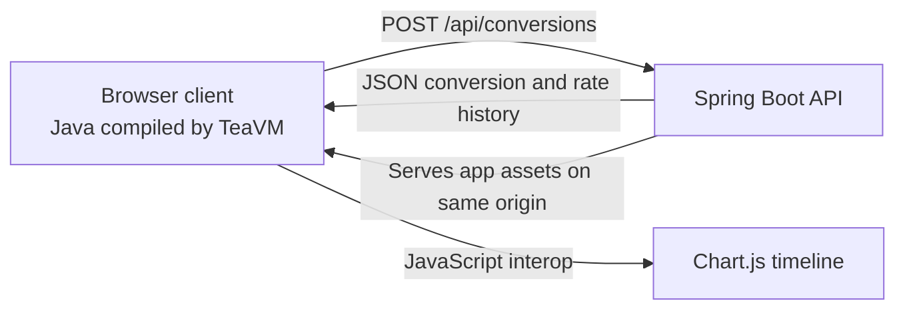

Java in the browser with TeaVM: three examples exploring how far you can take Java on the web, from a small game to a full-stack application and an interactive drawing editor.

[Previous: TeaVM: Getting Java into the Browser](/2026/10/17/teavm-getting-java-into-the-browser.html)

In the first article, I used [TeaVM](https://teavm.org/) to take a small Java number-guessing game into the browser. It was a useful introduction to the basic idea: write Java, compile it for the browser, and interact with the page without rewriting the application in JavaScript.

For the next example, I wanted to try something a little closer to a conventional web application.

This time, we're building a currency conversion explorer. It has a form, sends an asynchronous request to a REST API, handles a JSON response, and renders a chart using an existing JavaScript library.

The browser application is still written primarily in Java. The server is a conventional Spring Boot application. Chart.js does what it does best: draw the chart.

The interesting part is how those pieces fit together.

## What we're building

The application lets you enter an amount, choose a source currency and a target currency, and request a conversion.

The interface shows the converted amount and exchange rate, alongside a chart of the selected currency pair's rate over time.

For this demonstration, the exchange rates are canned data supplied by our own Spring Boot API. They aren't live financial data. That makes the example predictable and easy to run, while still letting us explore the important parts of a web application.


## The shape of the application

There are three main pieces.

**The browser client** is written in Java and compiled by TeaVM. It manages the form, validates input, sends requests, handles responses, and updates the page.

**The backend** is a Spring Boot REST API. It owns the demonstration rates and performs the conversion calculation. The browser doesn't need to know how the rates are stored or how the result is calculated.

**The chart** is rendered with Chart.js, a JavaScript library. Rather than build a charting implementation ourselves, we'll use JavaScript interop to pass the relevant data to the library.

The overall flow looks like this:

1. The user submits the conversion form.
2. The Java client validates the input and displays a loading state.
3. The browser sends a JSON request to Spring Boot.
4. The API calculates the conversion and returns JSON, including a dated rate history for the selected pair.
5. The client displays the result and updates the chart with that history.



One deliberate simplification is that the browser and API share the same origin. Spring Boot serves the generated client assets as well as the API. That keeps the demo focused on the application rather than cross-origin configuration.

The implementation is in a single Maven module, `teavm-showcase-currency-converter`, which contains both the TeaVM client and the Spring Boot API.

## Start with the form

The form has an amount, two currency selectors and a submit button. The Java client reads and validates the amount before making an asynchronous request:

```java
String amount = AmountValidator.normalize(amountInput.getValue());
if (amount == null) {
    result.setTextContent("");
    status.setTextContent("Enter an amount greater than 0, up to 1,000,000, with no more than 2 decimal places.");
    return;
}

String from = fromInput.getValue();
String to = toInput.getValue();
long requestId = ++requestSequence;
requestInProgress = true;
submitButton.setAttribute("disabled", "");
result.setTextContent("");
status.setTextContent("Converting…");
```

The client validates the amount before making a request, then disables the button and shows a loading message. The next step is sending the form values through TeaVM's browser API.

## Send a JSON request

The Java client uses TeaVM's `XMLHttpRequest` wrapper to post the form data asynchronously to the Spring Boot API:

```java
XMLHttpRequest request = new XMLHttpRequest();
request.open("POST", "/api/conversions", true);
request.setRequestHeader("Content-Type", "application/json");
request.setOnReadyStateChange(readyStateEvent -> {
    if (request.getReadyState() == XMLHttpRequest.DONE) {
        finishRequest(requestId, request);
    }
});
request.onError(errorEvent -> finishNetworkError(requestId));
request.send("{\"amount\":" + amount + ",\"from\":\"" + from + "\",\"to\":\"" + to + "\"}");
```

The request body is assembled as a string in this example. `amount` has already been normalized by `AmountValidator`, and `from` and `to` come from selectors containing only the supported currency codes. The showcase doesn't use a JSON builder here; for arbitrary or user-controlled string values, use a JSON serializer rather than concatenating JSON by hand.

For an amount of 100 GBP converted to EUR, the request body is:

```json
{
  "amount": 100,
  "from": "GBP",
  "to": "EUR"
}
```

The API owns the exchange-rate data and calculation. The client gathers the input and displays the result.

## Handle the response

The ready-state handler calls `finishRequest` when the response arrives, while a network error goes to `finishNetworkError`. The response method ignores stale requests, restores the form and uses the API's error message for non-success statuses:

```java
private void finishRequest(long requestId, XMLHttpRequest request) {
    if (requestId != requestSequence || !requestInProgress) {
        return;
    }
    if (request.getStatus() == 0) {
        finishNetworkError(requestId);
        return;
    }
    requestInProgress = false;
    submitButton.removeAttribute("disabled");
    if (request.getStatus() < 200 || request.getStatus() >= 300) {
        status.setTextContent(readApiError(request.getResponseText()));
        return;
    }
```

For a successful status, the client parses the response into a TeaVM JSON overlay and checks the required fields before updating the page:

```java
try {
    ConversionResponseView response =
            (ConversionResponseView) JSON.parse(request.getResponseText());
    if (!isValid(response)) {
        throw new IllegalArgumentException("Invalid conversion response");
    }
    result.setTextContent(formatMoney(response.getAmount(), response.getFrom())
            + " = " + formatMoney(response.getResult(), response.getTo()));
    status.setTextContent("Rate: 1 " + response.getFrom() + " = "
            + response.getRate() + " " + response.getTo()
            + " · Fixture rates as of " + response.getAsOf() + ".");
    try {
        ChartInterop.update(response.getHistory(), response.getFrom(), response.getTo());
    } catch (RuntimeException e) {
        status.setTextContent(status.getTextContent()
                + " The rate history chart could not be updated.");
    }
} catch (RuntimeException e) {
    result.setTextContent("");
    status.setTextContent("The server returned an invalid response. Please try again.");
}
}
```

If the request can't reach the server, the client restores the submit button and shows a connection message:

```java
private void finishNetworkError(long requestId) {
    if (requestId != requestSequence || !requestInProgress) {
        return;
    }
    requestInProgress = false;
    submitButton.removeAttribute("disabled");
    status.setTextContent("Unable to reach the conversion service. Check your connection and try again.");
}
```

So the Java side handles each outcome: it restores the form after a response, shows API or connection errors, and only displays a conversion after parsing and validating a successful JSON response. The chart update is isolated, so a Chart.js failure doesn't hide a valid conversion.

The number-guessing game showed Java responding to browser events. Here, TeaVM's browser wrappers handle the form and asynchronous request, while a small JavaScript interop method hands the returned rate history to Chart.js.

## Let Chart.js draw the timeline

Interop is how the Java code compiled by TeaVM calls browser APIs or JavaScript code that already exists in the page. We use it here because Chart.js is a JavaScript library: the Java client can prepare the chart data, then hand it to Chart.js rather than reimplementing chart rendering in Java.

TeaVM provides a few ways to cross that boundary. Its JSO APIs give Java typed wrappers for browser objects such as the DOM and `XMLHttpRequest`, which the client has already used for the form and API request. For small JavaScript functions, `@JSBody` lets us write the JavaScript body and call it from Java. TeaVM also supports JavaScript object overlays and imported JavaScript modules for larger integrations.

The response contains a dated series of rate values for the selected pair, so we have enough data to show how that pair's demonstration rate changes over time. The TeaVM client passes the history to a small `@JSBody` method. It filters the response points, removes the previous chart if there is one, and uses the dates as labels and rates as the line data:

```javascript
const canvas = document.getElementById("rate-chart");
if (!canvas || !window.Chart) {
    throw new Error("Chart.js or its canvas is unavailable");
}
const rows = [];
if (history && Array.isArray(history)) {
    for (const item of history) {
        if (item && typeof item.date === "string"
                && Number.isFinite(item.rate) && item.rate > 0) {
            rows.push(item);
        }
    }
}
if (window.currencyRateChart) {
    window.currencyRateChart.destroy();
    window.currencyRateChart = undefined;
}
if (rows.length === 0) {
    return;
}
const chart = new Chart(canvas, {
    type: "line",
    data: {
        labels: rows.map(item => item.date),
        datasets: [{
            label: "1 " + source + " to " + target,
            data: rows.map(item => item.rate),
            borderColor: "#4f46e5",
            backgroundColor: "rgb(79 70 229 / 12%)",
            fill: true,
            tension: 0.25,
            pointRadius: 3
        }]
    },
    options: {
        responsive: true,
        maintainAspectRatio: false,
        plugins: { legend: { display: true } },
        scales: {
            x: { title: { display: true, text: "Demo date" } },
            y: { title: { display: true, text: "Target units per source unit" } }
        }
    }
});
window.currencyRateChart = chart;
```

The bridge maps each valid history date to a chart label and each rate to a data point. It destroys the previous chart before drawing the updated one, and leaves the chart clear if the response has no usable points. Here, the timeline contains 7 generated samples ending at the selected pair's fixed fixture rate. They're illustrative, not historical market quotes, and Chart.js is served locally rather than loaded from a CDN.

This is a useful example of treating TeaVM as part of a web stack rather than as a requirement to avoid JavaScript entirely. The application logic can remain in Java while browser APIs and third-party libraries remain available where they make sense.

## What this demonstrates

The currency explorer takes the original example a step further. It shows Java compiled for the browser working with a server-side Java application, asynchronous JSON requests and an established JavaScript visualisation library.

It doesn't mean every part of a web application needs to be written in Java, nor that JavaScript libraries need to be avoided. Instead, it gives us a concrete example of where TeaVM fits: Java application logic running in the browser, connected to ordinary web APIs and browser capabilities.

The best way to judge the approach is to try the application, follow the request from the form to the server and back again, and look at the small interop boundary that hands the dated rate history to Chart.js.

That's what the showcase is for: a working example that makes the idea tangible.

## Try it yourself

The [TeaVM showcase currency explorer](https://github.com/teggr/teavm-showcase/tree/main/teavm-showcase-currency-converter) contains the TeaVM client and Spring Boot API in one module. From the showcase repository root, build and test it, then run the executable application:

```bash
mvn -pl teavm-showcase-currency-converter clean verify
java -jar teavm-showcase-currency-converter/target/teavm-showcase-currency-converter-1.0-SNAPSHOT.jar
```

Open <http://localhost:8080/>. Spring Boot serves the browser app and API from the same origin.

[Next: Building a Drawing App with Java, TeaVM and HTML Canvas](/2026/10/19/building-drawing-app-java-teavm-html-canvas.html)
