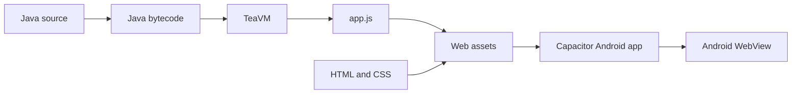

We've already taken Java into the browser with TeaVM, then [onto the desktop with JCEF](/2026/10/29/taking-teavm-to-the-desktop-with-jcef-and-jr.html). The next question was whether the same approach could reach a phone, including access to something on the device.

The result is [teggr/teavm-capacitor-demo](https://github.com/teggr/teavm-capacitor-demo), a small Java Repository Explorer running inside an Android app. Java handles the application behaviour, TeaVM compiles it to JavaScript, and Capacitor supplies the mobile container.

Really, this is a proof of concept for one chain:

```text
Java -> JavaScript -> mobile
```

The useful extra is that we can cross back out of the web interface and call a native platform plugin from the Java code.

## Start with a small web app

For this experiment I used a repository explorer rather than moving the game onto another platform. Enter a GitHub username and the app loads up to 10 public repositories, sorted by their most recent update. Each card shows the name, description, language, stars and update date.

Here's the app running in the Android emulator:


It's enough of an application to exercise input, an asynchronous request, response parsing and rendering. Java also handles loading, empty results, errors and retry.

The browser side follows the approaches from [the first TeaVM article](/2026/10/17/teavm-getting-java-into-the-browser.html) and [the currency explorer](/2026/10/18/from-java-to-web-app-currency-explorer-with-teavm.html). TeaVM's JSO APIs connect Java to the DOM, while small interop methods reach browser functions such as `fetch`. The HTML and CSS provide the page around that behaviour.

There's no backend service in this demo. The client calls GitHub's public REST API directly, without authentication, so network access and GitHub's unauthenticated rate limits still apply.

## Give the generated web app a mobile home

[Capacitor](https://capacitorjs.com/docs) is a native runtime for web apps. For this project, it packages the generated web assets into an Android application and loads them in a WebView.

That makes the build boundary fairly small:



The [Maven build](https://github.com/teggr/teavm-capacitor-demo/blob/main/pom.xml) uses TeaVM 0.16.0 to produce `app.js` and puts it alongside the HTML and CSS in `target/web`.

Capacitor's [configuration](https://github.com/teggr/teavm-capacitor-demo/blob/main/native/capacitor.config.json) points `webDir` at `../target/web`. Running `cap sync android` copies those assets into the Android project and synchronizes its plugins.

The Java application code runs as JavaScript inside the WebView. The interface is still HTML and CSS, and Capacitor provides the native shell and bridge. That distinction matters when thinking about rendering, performance and which Java libraries can be used: TeaVM's supported browser runtime is the target, rather than a general-purpose JVM on the phone.

## Call a platform plugin from Java

Packaging a web page gets us onto the device. Calling the [Capacitor Device plugin](https://capacitorjs.com/docs/apis/device) demonstrates the other half of the experiment.

The app has a runtime-information section which calls `Device.getInfo()` and displays the platform, operating system version and model. On the verified emulator run, that returned `android`, `android 15` and `sdk_gphone64_x86_64`.

The call crosses a few boundaries:

```text
Java DeviceInfo.load()
    -> TeaVM JavaScript interop
    -> Capacitor Device.getInfo()
    -> native Android plugin
    -> Promise result back to Java callbacks
    -> DOM update
```

The [interop wrapper](https://github.com/teggr/teavm-capacitor-demo/blob/main/src/main/java/dev/teggr/jre/interop/Capacitor.java) uses a small `@JSBody` method to call the plugin:

```java
@JSBody(params = {"plugin", "method"}, script = ""
        + "var c = window.Capacitor;"
        + "var p = (c.Plugins && c.Plugins[plugin]) || c.registerPlugin(plugin);"
        + "return p[method]();")
private static native <T extends JSObject> JSPromise<T> call(String plugin, String method);
```

[`DeviceInfo`](https://github.com/teggr/teavm-capacitor-demo/blob/main/src/main/java/dev/teggr/jre/device/DeviceInfo.java) calls that bridge with `"Device", "getInfo"` and passes the asynchronous result back to the application to update the page. An unavailable plugin or a failed call gets reported in the UI.

This reuses the interop idea from [the Chart.js integration](/2026/10/18/from-java-to-web-app-currency-explorer-with-teavm.html): keep application behaviour in Java and use a small boundary to reach an existing JavaScript API. Here, that API leads to native device functionality.

This demo uses Capacitor's injected bridge without adding a JS bundler, though the native plugin still needs installing and synchronizing. The [repository](https://github.com/teggr/teavm-capacitor-demo) has the binding details; plugins needing arguments, permissions or listeners would take more work.

## Try the complete chain

From the demo repository root, these PowerShell commands build the Java code, synchronize the assets and launch Android:

```powershell
.\mvnw.cmd clean package
Set-Location native
npm ci
npx cap sync android
npx cap run android
```

Use JDK 21 for the Android build, Node.js 22 or newer, and an Android SDK with an emulator or connected device. The [README](https://github.com/teggr/teavm-capacitor-demo#build-and-run) has the SDK versions, environment setup and an ADB fallback for the deployment timeout encountered during verification.

After changing Java, rebuild with Maven and run `cap sync android` again. Otherwise, the Android project still carries the previous generated assets.

You can also serve `target/web` in a regular browser. The repository explorer works there, while the runtime section explicitly reports that the native bridge isn't present.

## What this proves, and what's still open

The repository records a working browser run and an Android emulator run, including live GitHub requests and a successful native Device plugin call. The screenshot shows the repository UI; the device-info result is documented separately in the [verification notes](https://github.com/teggr/teavm-capacitor-demo#verification-status).

Physical-device testing, a signed release build and iOS remain outside this experiment. There's also more to explore around lifecycle behaviour, offline use and plugins with richer APIs before treating this as an application foundation.

Guided by my Copilot Agent, I've been able to discuss the approach, understand how the pieces fit and ultimately bring this proof of concept to life. I can now see a nice path forward for using Java in a multi-platform architecture.
